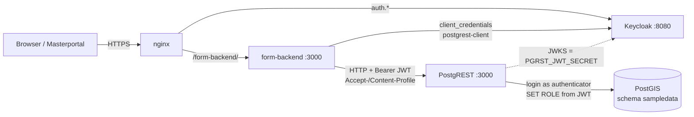
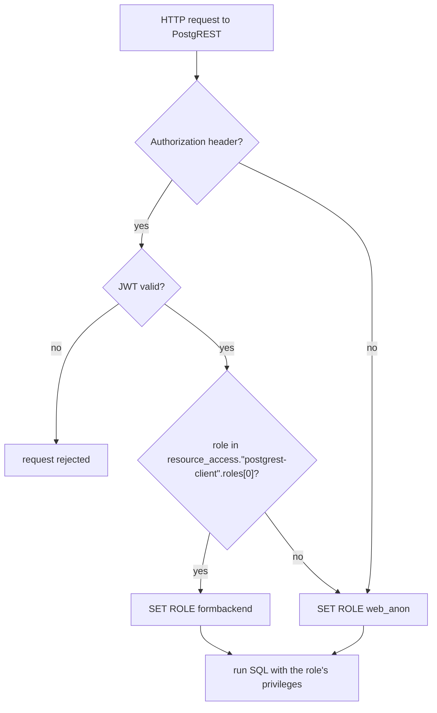
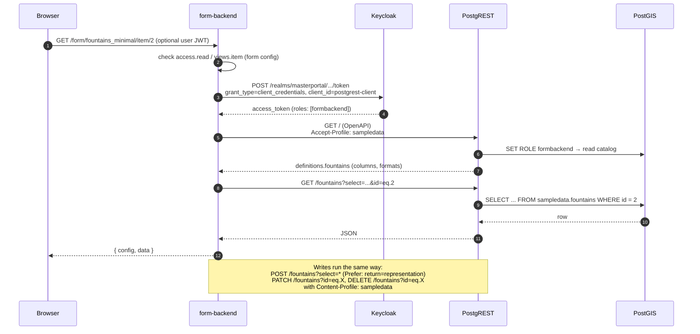

# Data Access: Overview

How form-backend reads and writes data in the database. For setup details and debugging, see [database-debug.md](database-debug.md).

## 1. Components

form-backend doesn't talk to the database directly. It goes through **PostgREST**, which turns HTTP requests into SQL. **Keycloak** issues the tokens that tell PostgREST which database role to use.

| Component | Role in data access |
|-----------|---------------------|
| form-backend | Reads the form configs, checks the end user's access, and sends HTTP requests to PostgREST |
| Keycloak | Issues a service-account token for form-backend (client `postgrest-client`) and checks end-user logins |
| PostgREST | Validates the token, switches to the matching database role, and runs the SQL |
| PostGIS | Stores the data; its grants decide what each role may do |

PostgREST isn't exposed to the outside. Only form-backend reaches it, inside the internal network.

## 2. Database roles

| Role | Can log in | Purpose |
|------|------------|---------|
| `authenticator` | yes | The only role PostgREST logs in with. It has no data privileges of its own and only switches to one of the roles below |
| `formbackend` | no | Used for every request from form-backend. It may read and write the form tables |
| `web_anon` | no | The anonymous role: used for requests **without** a token, and for valid tokens that **carry no role** in the configured claim. Intended to be read-only; in the demo it only has SELECT. What it may actually do depends on the grants. form-backend always sends a token with the role `formbackend`, so it uses `web_anon` only if the Keycloak service account is missing that role |

For each request, PostgREST picks the role from the token:

## 3. Request flow

form-backend **never forwards the end user's token to PostgREST**. For every request it gets a fresh service-account token from Keycloak, so all form requests run as `formbackend` in the database. Before each operation, form-backend also loads the table description (columns and data types) from PostgREST.

How form operations map to PostgREST requests and database privileges:

| Form operation | PostgREST request | Privilege of `formbackend` |
|----------------|-------------------|----------------------------|
| List | `GET /<table>?select=…&order=…&offset=…&limit=…` | SELECT |
| Show item | `GET /<table>?id=eq.<id>` | SELECT |
| Create | `POST /<table>` (without `id`) | INSERT, plus USAGE on the id sequence |
| Update | `PATCH /<table>?id=eq.<id>` | UPDATE, SELECT |
| Delete | `DELETE /<table>?id=eq.<id>` | DELETE, SELECT |
| Lookup lists (e.g. fountain types) | `GET /<lookup table>?select=…` | SELECT on the lookup table |
| Links in join tables | `POST` / `DELETE` on the join table | INSERT, DELETE on the join table |

The `Accept-Profile` / `Content-Profile` header selects the schema. It's the `schema` from the form config, or form-backend's default schema.

## 4. Who may do what

There are two separate layers:

1. **End user → form-backend.** form-backend reads the end user's roles from their Keycloak token (client `form-backend-app`). It compares them with `access.read` / `access.write` in the form config. `true` means everyone, including anonymous users; a list of roles, e.g. `["fountains_editor"]`, restricts access to those roles.
2. **form-backend → database.** Every request runs as `formbackend`, whoever the end user is. The database grants define the **maximum** form-backend can do; they don't tell users apart.

So the form config controls access per user, and the database grants control access per role.

## 5. What a form table needs in the database

- **Exposed schema:** the table's schema is in PostgREST's `db-schemas`, and `formbackend` has `USAGE` on it.
- **Grants:** `formbackend` has SELECT, INSERT, UPDATE and DELETE on the table, plus SELECT on its lookup tables.
- **Generated id:** form-backend leaves out the id when it creates a row, so the id column needs a default (identity, or a sequence that `formbackend` may use).
- **Foreign keys for lookups:** lookups and embedded related data rely on real foreign keys.
- **Required fields:** NOT NULL columns without a default must always be filled by the form.
- **New tables:** after creating a table, grant on it and run `NOTIFY pgrst, 'reload schema';` so that PostgREST sees it.
