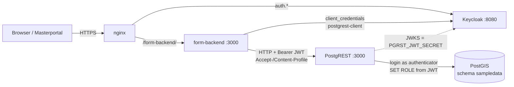
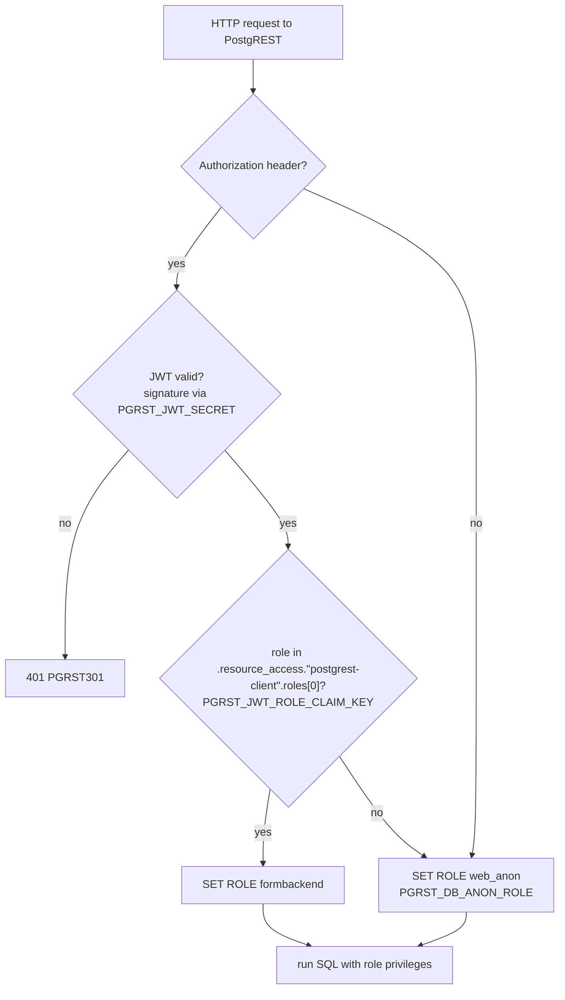
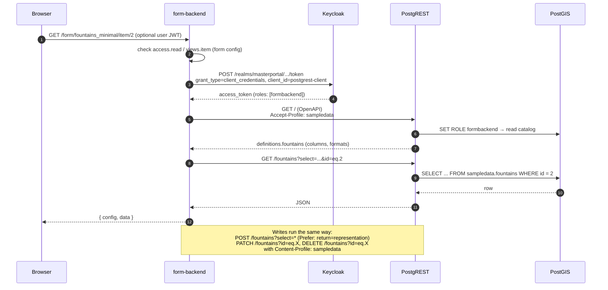
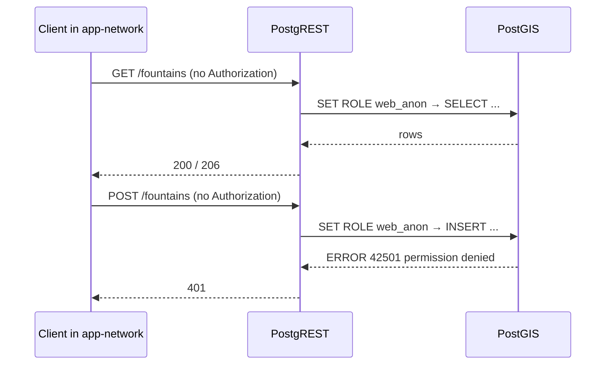
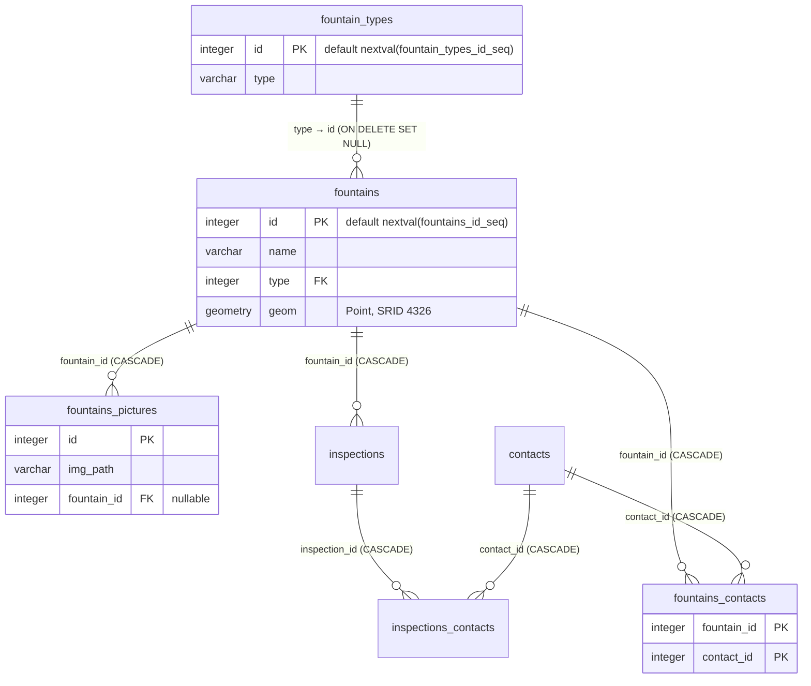

# Database Debug Guide: `fountains`

This guide covers the database side of the form-backend demo and how to debug it. It uses the table `sampledata.fountains` as the running example. It explains the following:

- which roles and grants PostGIS needs
- which constraints and defaults the table has
- how form-backend and PostgREST reach the data
- how to check every link of that chain with SQL and HTTP calls

Every SQL statement and HTTP request in this guide was run against the dev stack (`docker-compose.yml` + `docker-compose.override.dev.yml`). The outputs shown are real, shortened where marked.

For a production deployment (no dev override, real data), use the read-only check suite in [database-permission-checks-production.md](database-permission-checks-production.md).

- [1. Quick checklist](#1-quick-checklist)
- [2. Architecture and data paths](#2-architecture-and-data-paths)
- [3. Database setup, step by step](#3-database-setup-step-by-step)
- [4. The `fountains` table](#4-the-fountains-table)
- [5. How form-backend accesses `fountains`](#5-how-form-backend-accesses-fountains)
- [6. Grant reference](#6-grant-reference)
- [7. Debug SQL](#7-debug-sql)
- [8. Debugging at the PostgREST level](#8-debugging-at-the-postgrest-level)
- [9. Error → cause](#9-error--cause)
- [10. Known pitfalls](#10-known-pitfalls)

---

## 1. Quick checklist

Work through these checks top to bottom. The first one that fails is usually the cause.

| # | Check | Expected | Section |
|---|-------|----------|---------|
| 1 | Roles `authenticator`, `web_anon`, `formbackend` exist | `authenticator` can log in; the other two can't | [7.1](#71-roles-and-memberships) |
| 2 | `authenticator` is a member of `web_anon` and `formbackend` | `set_option = t` for both | [7.1](#71-roles-and-memberships) |
| 3 | `authenticator` password in DB = `PGRST_DB_PASSWORD` in `.env` | Login over TCP works | [7.1](#71-roles-and-memberships) |
| 4 | `USAGE` on schema `sampledata` | `t` for `web_anon` and `formbackend` | [7.2](#72-privilege-matrix) |
| 5 | Table privileges on `fountains` and its related tables | `web_anon`: SELECT. `formbackend`: SELECT/INSERT/UPDATE/DELETE | [7.2](#72-privilege-matrix) |
| 6 | Sequence privileges on `fountains_id_seq` | `formbackend`: USAGE | [7.2](#72-privilege-matrix) |
| 7 | `formbackend` can update `__form_backend_healthcheck` | SELECT and UPDATE | [7.2](#72-privilege-matrix) |
| 8 | No RLS policy blocks rows | `relrowsecurity = f`, or matching policies | [7.3](#73-row-level-security) |
| 9 | The service token carries the role `formbackend` | `resource_access."postgrest-client".roles[0] = "formbackend"` | [8.2](#82-service-token-as-formbackend) |
| 10 | The schema is exposed in PostgREST (`PGRST_DB_SCHEMAS`) | No `PGRST106` | [8.3](#83-schema-exposure-accept-profile--content-profile) |

---

## 2. Architecture and data paths

### 2.1 Components



PostgREST isn't published by nginx and has no host port. It's only reachable inside the Docker network `form-backend-demo_app-network`, as `http://postgrest:3000`.

### 2.2 Role switching in PostgREST

PostgREST always connects as `authenticator`. For each request it switches to a role:



`authenticator` itself has no privileges on `sampledata`. Everything comes from the role it switches to.

### 2.3 Read and write through form-backend

form-backend **never forwards the end-user token to PostgREST**. For every API request it fetches a new service-account token from Keycloak (client credentials of `postgrest-client`), so in the DB every form request runs as `formbackend`. Which end user may read or write is decided in form-backend alone, by `access.read` / `access.write` in the form config (see [5.5](#55-end-user-authorization-is-not-db-authorization)).



### 2.4 Direct anonymous access to PostgREST

`web_anon` is used when PostgREST is called **without** a token, and also when a valid token has **no role** in the claim `PGRST_JWT_ROLE_CLAIM_KEY` (verified). form-backend always sends a token. It only ends up as `web_anon` if the service account of `postgrest-client` is missing the client role `formbackend`: reads then still work, but writes fail with `42501`.



---

## 3. Database setup, step by step

PostgreSQL runs the scripts in `postgres/init_data/` once, in alphabetical order, when the data directory `postgres/data` is first created. `initDev.sh` then runs the steps that need values only known after Keycloak has started.

| Step | What | Where |
|------|------|-------|
| 1 | Enable PostGIS | `01_init_sampledata.sql` |
| 2 | Create the schema `sampledata` (owner `postgres`) | `01_init_sampledata.sql` |
| 3 | Create tables, sequences, defaults, data, `setval` | `01_init_sampledata.sql` |
| 4 | Add constraints (PK, FK, UNIQUE) | `01_init_sampledata.sql` |
| 5 | Create roles `web_anon`, `formbackend`, `authenticator` | `99_init_postgrest.sql` |
| 6 | Grant privileges on the schema, tables and sequences | `99_init_postgrest.sql` |
| 7 | Make `authenticator` a member of both roles | `99_init_postgrest.sql` |
| 8 | Set the `authenticator` password from `.env` | `initDev.sh` |
| 9 | Run the migrations (healthcheck table) | `initDev.sh` → `postgres/migrations/*.sql` |

**Step 1-2: extension and schema**

```sql
SET search_path TO public;
CREATE EXTENSION IF NOT EXISTS postgis;
CREATE SCHEMA sampledata;
ALTER SCHEMA sampledata OWNER TO postgres;
```

PostGIS is installed in `public`. That's why PostgREST's OpenAPI reports the geometry column as `public.geometry(Point,4326)`.

**Steps 3-4: table, sequence and constraints.** See [section 4](#4-the-fountains-table).

**Steps 5-7: roles and grants** (`postgres/init_data/99_init_postgrest.sql`)

```sql
-- anonymous role for PostgREST: can't log in, read-only
CREATE ROLE web_anon NOINHERIT NOLOGIN;
-- role for form-backend: full CRUD on the data tables
CREATE ROLE formbackend NOINHERIT NOLOGIN;
-- the only role PostgREST logs in with; it has no privileges of its own
CREATE ROLE authenticator LOGIN NOINHERIT NOCREATEDB NOCREATEROLE NOSUPERUSER;

GRANT USAGE ON SCHEMA sampledata TO formbackend;
GRANT SELECT, INSERT, UPDATE, DELETE ON ALL TABLES IN SCHEMA sampledata TO formbackend;
GRANT ALL ON ALL SEQUENCES IN SCHEMA sampledata TO formbackend;

GRANT USAGE ON SCHEMA sampledata TO web_anon;
GRANT SELECT ON ALL TABLES IN SCHEMA sampledata TO web_anon;
GRANT SELECT ON ALL SEQUENCES IN SCHEMA sampledata TO web_anon;

GRANT web_anon TO authenticator;
GRANT formbackend TO authenticator;
```

- `ON ALL TABLES` only covers tables that **already exist** when the statement runs. See [10.1](#101-no-default-privileges--new-tables-are-invisible).
- `NOINHERIT` on `authenticator` is intentional: it gets the privileges of a role only after `SET ROLE`, never automatically.

**Step 8: `authenticator` password** (`initDev.sh`). `PGRST_DB_URI` uses this password:

```sql
ALTER USER authenticator WITH PASSWORD '<PGRST_DB_PASSWORD>';
```

**Step 9: healthcheck migration** (`postgres/migrations/V1.0.0_form_backend_testtable.sql`)

```sql
CREATE TABLE IF NOT EXISTS sampledata.__form_backend_healthcheck (
    id Serial NOT NULL PRIMARY KEY,
    last_start timestamp without time zone
);
INSERT INTO sampledata.__form_backend_healthcheck (id, last_start) VALUES (1, TO_TIMESTAMP('1970-01-01','YYYY-MM-DD'));
ALTER TABLE sampledata.__form_backend_healthcheck OWNER TO postgres;
GRANT SELECT, UPDATE ON TABLE sampledata.__form_backend_healthcheck TO formbackend;
```

The migration runs after `99_init_postgrest.sql`, so the `ON ALL TABLES` grants don't cover this table. It needs its own `GRANT`, and gives nothing to `web_anon`. Its sequence `__form_backend_healthcheck_id_seq` needs no grant, because form-backend only updates row `id = 1` and never inserts. Running the migration again prints `duplicate key ... __form_backend_healthcheck_pkey`, which is harmless.

---

## 4. The `fountains` table

### 4.1 Data model



### 4.2 Definition

```sql
CREATE TABLE sampledata.fountains (
    id integer NOT NULL,
    name character varying,
    type integer,
    geom geometry(Point, 4326)
);
ALTER TABLE sampledata.fountains OWNER TO postgres;

CREATE SEQUENCE sampledata.fountains_id_seq AS integer START WITH 1 INCREMENT BY 1 NO MINVALUE NO MAXVALUE CACHE 1;
ALTER SEQUENCE sampledata.fountains_id_seq OWNER TO postgres;
ALTER SEQUENCE sampledata.fountains_id_seq OWNED BY sampledata.fountains.id;
ALTER TABLE ONLY sampledata.fountains ALTER COLUMN id SET DEFAULT nextval('sampledata.fountains_id_seq'::regclass);

-- after loading the data with COPY ... (ids 1..50):
SELECT setval('sampledata.fountains_id_seq', 51, true);

ALTER TABLE ONLY sampledata.fountains ADD CONSTRAINT tree_pk PRIMARY KEY (id);
ALTER TABLE ONLY sampledata.fountains
    ADD CONSTRAINT fountains_fk FOREIGN KEY (type) REFERENCES sampledata.fountain_types(id) ON DELETE SET NULL;
```

### 4.3 Columns, constraints and defaults explained

| Column | Type | Null | Default | Constraint | Notes |
|--------|------|------|---------|------------|-------|
| `id` | `integer` | NOT NULL | `nextval('sampledata.fountains_id_seq')` | PK `tree_pk` | form-backend removes `id` from the body on create, so the sequence default fills it. The inserting role therefore needs **USAGE on the sequence**. |
| `name` | `varchar` | yes | – | – | No length limit, so OpenAPI shows no `maxLength`. |
| `type` | `integer` | yes | – | FK `fountains_fk` → `fountain_types(id)` **ON DELETE SET NULL** | Deleting a type sets `type = NULL` on all affected fountains. A value with no matching type fails with `23503`. PostgREST needs this FK to embed `type(id,type)`. |
| `geom` | `geometry(Point,4326)` | yes | – | typmod Point/SRID 4326 | Any other geometry type or SRID fails with `Geometry SRID (25832) does not match column SRID (4326)`. PostgREST returns GeoJSON. |

Related constraints that point at `fountains`:

| Table | Constraint | Effect |
|-------|------------|--------|
| `fountains_pictures` | `fountains_pictures_fk` (`fountain_id`) ON DELETE CASCADE | Pictures are deleted together with the fountain. `fountain_id` is **nullable**, because when form-backend removes a picture from a form it sets `fountain_id = NULL` instead of deleting the row. |
| `inspections` | `fountains_fk_1` (`fountain_id`) ON DELETE CASCADE | Same as above: nullable, cascade. |
| `fountains_contacts` | PK `(fountain_id, contact_id)`, plus UNIQUE `fountains_contacts_un` on the same columns; FKs with CASCADE to both sides | Many-to-many link. The UNIQUE is redundant. |

**Sequence notes**

- `setval(..., 51, true)` after the COPY means the next `nextval` returns 52. If the sequence is behind `max(id)`, inserts fail with `duplicate key value violates unique constraint "tree_pk"`. See [7.4](#74-constraints-defaults-sequence) for the check.
- `nextval` isn't transactional. A rolled-back insert, such as the tests in [7.5](#75-role-impersonation-tests-nothing-is-persisted), still uses up an id. Gaps in `id` are normal.

---

## 5. How form-backend accesses `fountains`

The source paths below refer to the form-backend repository (`backend/src/...`).

### 5.1 Configuration chain

| Setting | Value in the demo | Effect |
|---------|-------------------|--------|
| `PGRST_DB_URI` | `postgres://authenticator:${PGRST_DB_PASSWORD}@db:5432/postgres` | PostgREST login |
| `PGRST_DB_SCHEMAS` | `sampledata` | Only these schemas can be addressed through the profile headers |
| `PGRST_DB_ANON_ROLE` | `web_anon` | Role used for requests without a token, or with a token that has no role claim |
| `PGRST_JWT_SECRET` | JWKS of realm `masterportal` (written by `initDev.sh`) | Validates the token signature |
| `PGRST_JWT_ROLE_CLAIM_KEY` | `.resource_access."postgrest-client".roles[0]` | Claim that holds the DB role |
| Keycloak client `postgrest-client` | confidential, service account enabled; the service account has client role `formbackend` | Puts `formbackend` into that claim |
| form-backend `POSTGREST_JWT_CLIENT_ID` / `POSTGREST_KEYCLOAK_CLIENT_SECRET` | `postgrest-client` / `PGRST_KEYCLOAK_CLIENT_SECRET` | Client credentials for the token |
| form-backend `POSTGREST_DEFAULT_SCHEMA` | `sampledata` (code default: `public`) | Profile header when the form config sets no `dataSource.schema` |

The DB role name, the Keycloak client role name and the role claim key must match **exactly**.

### 5.2 Form config → table

`form-backend/form_configs/fountains_minimal.json`:

```json
{
  "dataSource": { "tableName": "fountains", "idColumn": "id" },
  "views": { "table": true, "item": true },
  "access": { "read": true, "write": true }
}
```

There's no `schema` key, so `POSTGREST_DEFAULT_SCHEMA` (`sampledata`) is used, and there's no `includedProperties`, so every column visible in OpenAPI is used. `fountains.json` adds a lookup for `type` → `fountain_types`. `fountains_advanced.json` adds join tables (`contacts` via `fountains_contacts`, `fountains_pictures`, `inspections`).

### 5.3 PostgREST requests and required privileges

Every request carries `Authorization: Bearer <service token>`. GET requests send `Accept-Profile: sampledata`; POST, PATCH and DELETE send `Content-Profile: sampledata`.

| Trigger | PostgREST request | Privilege needed by `formbackend` |
|---------|-------------------|-------------------------------|
| startup healthcheck (`app.ts`) | `PATCH /__form_backend_healthcheck?id=eq.1` with body `{"last_start": ...}`; expects 2xx | SELECT and UPDATE on `__form_backend_healthcheck` |
| every form request: schema discovery (`processor/formConfig.ts`) | `GET /` (OpenAPI), reading `definitions.fountains` | any privilege on the table (OpenAPI lists only tables the role can access) |
| lookup enum (`fountains.json`) | `GET /fountain_types?select=id,type` | SELECT on `fountain_types` |
| list / table view | `GET /fountains?select=...&order=id.asc&offset=0&limit=N` with `Prefer: count=exact` (count from `Content-Range`) | SELECT (+ SELECT on `fountain_types` for the `type(id,type)` embed) |
| item view | `GET /fountains?select=...&id=eq.X` | SELECT |
| create | `POST /fountains?select=*` with `Prefer: return=representation`, without `id` | INSERT, SELECT (representation), USAGE on `fountains_id_seq` |
| update | `PATCH /fountains?id=eq.X` → 204 | UPDATE, SELECT (for the filter) |
| delete | `DELETE /fountains?id=eq.X` → 204 | DELETE, SELECT; cascades run as the FK's internal trigger, so no extra privilege is needed on child tables |
| M2M link (`fountains_advanced.json`) | `POST /fountains_contacts`, `DELETE /fountains_contacts?fountain_id=eq.X&contact_id=in.(...)` with `Content-Profile: <via.schema>` | INSERT and DELETE on `fountains_contacts` |
| 1:n unlink | `PATCH /fountains_pictures?id=eq.X` with `{"fountain_id": null}` | UPDATE on the child table; the FK column must be nullable |

File uploads (`media.binaryEncoding: base64`) are written to disk by form-backend (`FILE_UPLOAD_DIR`). Only the relative path ends up in a `varchar` column such as `img_path`, so they need no extra DB privilege.

### 5.4 What form-backend takes from the schema

Of the OpenAPI definition, form-backend uses only `properties`: `type`, `format`, `default`, `maxLength`, `enum`, and the `description` containing `<pk/>` / `<fk .../>`. This is the real definition of `fountains` for the role `formbackend`:

```json
{"required":["id"],
 "properties":{
  "id":{"description":"Note:\nThis is a Primary Key.<pk/>","format":"integer","type":"integer"},
  "name":{"format":"character varying","type":"string"},
  "type":{"description":"Note:\nThis is a Foreign Key to `fountain_types.id`.<fk table='fountain_types' column='id'/>","format":"integer","type":"integer"},
  "geom":{"format":"public.geometry(Point,4326)","type":"string"}},
 "type":"object"}
```

- `required` (NOT NULL) is **not** evaluated by form-backend. A NOT NULL column without a default only fails at insert time, with `23502`.
- The `nextval` default of `id` does **not** show up in OpenAPI. form-backend can still create rows only because it always removes `id` from the body.

### 5.5 End-user authorization is not DB authorization

- form-backend reads the end user's roles from their token, in `resource_access["form-backend-app"].roles` (`KC_CLIENT_APP_ID`). In the demo, the group `/editors` grants `fountains_editor`.
- `access.read` / `access.write` in the form config are either `true` (everyone, including anonymous users) or an array of role names.
- A missing or invalid user token is treated as "no roles". form-backend doesn't reject it outright.
- In the DB, every request is `formbackend`, whoever the user is. So `fountains_minimal.json` (`read/write: true`) lets **anonymous users create, change and delete fountains**, while `fountains.json` / `fountains_advanced.json` require `fountains_editor`.

---

## 6. Grant reference

These are all the grants the `fountains` example needs, as one block. All statements can be run again safely; run them as `postgres`:

```sql
-- roles
-- CREATE ROLE web_anon NOINHERIT NOLOGIN;
-- CREATE ROLE formbackend NOINHERIT NOLOGIN;
-- CREATE ROLE authenticator LOGIN NOINHERIT NOCREATEDB NOCREATEROLE NOSUPERUSER;
GRANT web_anon    TO authenticator;
GRANT formbackend TO authenticator;

-- schema
GRANT USAGE ON SCHEMA sampledata TO web_anon, formbackend;

-- formbackend: CRUD on fountains and every table used through lookups/joins
GRANT SELECT, INSERT, UPDATE, DELETE ON
    sampledata.fountains,
    sampledata.fountain_types,
    sampledata.fountains_pictures,
    sampledata.fountains_contacts,
    sampledata.contacts,
    sampledata.inspections,
    sampledata.inspections_contacts
TO formbackend;
-- sequences for INSERT with a default id
GRANT USAGE, SELECT ON
    sampledata.fountains_id_seq,
    sampledata.fountain_types_id_seq,
    sampledata.fountains_pictures_id_seq,
    sampledata.contacts_id_seq,
    sampledata.inspections_id_seq
TO formbackend;
-- healthcheck
GRANT SELECT, UPDATE ON sampledata.__form_backend_healthcheck TO formbackend;

-- web_anon: read-only
GRANT SELECT ON
    sampledata.fountains,
    sampledata.fountain_types,
    sampledata.fountains_pictures,
    sampledata.fountains_contacts,
    sampledata.contacts,
    sampledata.inspections,
    sampledata.inspections_contacts
TO web_anon;
```

| Object | `web_anon` | `formbackend` | `authenticator` |
|--------|-----------|---------------|-----------------|
| schema `sampledata` | USAGE | USAGE | – |
| `fountains` and related tables | SELECT | SELECT, INSERT, UPDATE, DELETE | – |
| `*_id_seq` | SELECT (init script; not needed) | USAGE, SELECT, UPDATE | – |
| `__form_backend_healthcheck` | – | SELECT, UPDATE | – |
| membership | – | – | member of `web_anon`, `formbackend` |

---

## 7. Debug SQL

Open a shell as superuser:

```bash
docker compose exec db psql -U postgres
```

### 7.1 Roles and memberships

```sql
SELECT rolname, rolcanlogin, rolinherit, rolsuper, rolbypassrls
FROM pg_roles WHERE rolname IN ('authenticator','web_anon','formbackend') ORDER BY 1;
```
```
    rolname    | rolcanlogin | rolinherit | rolsuper | rolbypassrls
---------------+-------------+------------+----------+--------------
 authenticator | t           | f          | f        | f
 formbackend   | f           | f          | f        | f
 web_anon      | f           | f          | f        | f
```

```sql
SELECT m.rolname AS member, r.rolname AS granted_role, a.inherit_option, a.set_option
FROM pg_auth_members a
JOIN pg_roles r ON r.oid = a.roleid
JOIN pg_roles m ON m.oid = a.member
WHERE m.rolname = 'authenticator';
```
```
    member     | granted_role | inherit_option | set_option
---------------+--------------+----------------+------------
 authenticator | web_anon     | f              | t
 authenticator | formbackend  | f              | t
```
`set_option = t` is required for PostgREST's `SET ROLE`. `inherit_option` and `set_option` exist since PostgreSQL 16.

**Can `authenticator` switch roles?** In the container, Unix socket connections are `trust`, so no password is needed:

```bash
docker compose exec db psql -U authenticator -d postgres
```
```sql
SELECT count(*) FROM sampledata.fountains;          -- ERROR: permission denied for schema sampledata  (correct!)
SET ROLE web_anon;    SELECT current_user, count(*) FROM sampledata.fountains;   -- web_anon    | 50
RESET ROLE;
SET ROLE formbackend; SELECT current_user, count(*) FROM sampledata.fountains;   -- formbackend | 50
RESET ROLE;
SET ROLE postgres;                                   -- ERROR: permission denied to set role "postgres"  (correct!)
```

**Does the password match `.env`?** This tests over TCP, which uses `scram-sha-256` like PostgREST does:

```bash
set -a; source .env; set +a
docker compose exec -T -e PGPASSWORD="$PGRST_DB_PASSWORD" db \
  psql -h localhost -U authenticator -d postgres -tAc 'select current_user'
# → authenticator
```

### 7.2 Privilege matrix

**Schema:**
```sql
SELECT r.role, n.nspname,
       has_schema_privilege(r.role, n.nspname, 'USAGE')  AS usage,
       has_schema_privilege(r.role, n.nspname, 'CREATE') AS "create"
FROM (VALUES ('web_anon'),('formbackend'),('authenticator')) r(role)
CROSS JOIN pg_namespace n WHERE n.nspname = 'sampledata' ORDER BY 1;
```
```
     role      |  nspname   | usage | create
---------------+------------+-------+--------
 authenticator | sampledata | f     | f
 formbackend   | sampledata | t     | f
 web_anon      | sampledata | t     | f
```

**Tables:**
```sql
SELECT r.role, c.relname,
  has_table_privilege(r.role, c.oid, 'SELECT') AS sel,
  has_table_privilege(r.role, c.oid, 'INSERT') AS ins,
  has_table_privilege(r.role, c.oid, 'UPDATE') AS upd,
  has_table_privilege(r.role, c.oid, 'DELETE') AS del
FROM (VALUES ('web_anon'),('formbackend')) r(role)
CROSS JOIN pg_class c JOIN pg_namespace n ON n.oid = c.relnamespace
WHERE n.nspname = 'sampledata' AND c.relkind IN ('r','v','m','p')
ORDER BY c.relname, r.role;
```
```
    role     |          relname           | sel | ins | upd | del
-------------+----------------------------+-----+-----+-----+-----
 formbackend | __form_backend_healthcheck | t   | f   | t   | f
 web_anon    | __form_backend_healthcheck | f   | f   | f   | f
 formbackend | fountain_types             | t   | t   | t   | t
 web_anon    | fountain_types             | t   | f   | f   | f
 formbackend | fountains                  | t   | t   | t   | t
 web_anon    | fountains                  | t   | f   | f   | f
 ...  (contacts, fountains_contacts, fountains_pictures, inspections, inspections_contacts: same pattern)
```

**Sequences:**
```sql
SELECT r.role, c.relname,
  has_sequence_privilege(r.role, c.oid, 'USAGE')  AS usage,
  has_sequence_privilege(r.role, c.oid, 'SELECT') AS sel,
  has_sequence_privilege(r.role, c.oid, 'UPDATE') AS upd
FROM (VALUES ('web_anon'),('formbackend')) r(role)
CROSS JOIN pg_class c JOIN pg_namespace n ON n.oid = c.relnamespace
WHERE n.nspname = 'sampledata' AND c.relkind = 'S'
ORDER BY c.relname, r.role;
```
```
    role     |              relname              | usage | sel | upd
-------------+-----------------------------------+-------+-----+-----
 formbackend | __form_backend_healthcheck_id_seq | f     | f   | f
 web_anon    | __form_backend_healthcheck_id_seq | f     | f   | f
 formbackend | fountains_id_seq                  | t     | t   | t
 web_anon    | fountains_id_seq                  | f     | t   | f
 ...
```
`nextval()` needs `USAGE` (or `UPDATE`). Without it, an insert as `formbackend` fails with `permission denied for sequence fountains_id_seq`.

**Columns.** Use this when column-level grants are in play, e.g. for the healthcheck:
```sql
SELECT attname,
       has_column_privilege('formbackend', 'sampledata.__form_backend_healthcheck', attname, 'SELECT') AS sel,
       has_column_privilege('formbackend', 'sampledata.__form_backend_healthcheck', attname, 'UPDATE') AS upd
FROM pg_attribute
WHERE attrelid = 'sampledata.__form_backend_healthcheck'::regclass AND attnum > 0 AND NOT attisdropped;
```
```
  attname   | sel | upd
------------+-----+-----
 id         | t   | t
 last_start | t   | t
```

**Raw ACLs and default privileges:**
```sql
\dp sampledata.fountains
```
```
   Schema   |   Name    | Type  |     Access privileges      | Column privileges | Policies
------------+-----------+-------+----------------------------+-------------------+----------
 sampledata | fountains | table | postgres=arwdDxtm/postgres+|                   |
            |           |       | formbackend=arwd/postgres +|                   |
            |           |       | web_anon=r/postgres        |                   |
```
(`r` = SELECT, `a` = INSERT, `w` = UPDATE, `d` = DELETE)

```sql
\ddp
```
```
         Default access privileges
 Owner | Schema | Type | Access privileges
-------+--------+------+-------------------
(0 rows)
```
There are no default privileges. See [10.1](#101-no-default-privileges--new-tables-are-invisible).

**Overview from `information_schema`:**
```sql
SELECT grantee, table_name, string_agg(privilege_type, ',' ORDER BY privilege_type)
FROM information_schema.role_table_grants
WHERE table_schema = 'sampledata' AND grantee IN ('web_anon','formbackend')
GROUP BY 1, 2 ORDER BY 2, 1;
```

### 7.3 Row level security

```sql
SELECT c.relname, c.relrowsecurity, c.relforcerowsecurity
FROM pg_class c JOIN pg_namespace n ON n.oid = c.relnamespace
WHERE n.nspname = 'sampledata' AND c.relkind = 'r' ORDER BY 1;

SELECT schemaname, tablename, policyname, roles, cmd, qual
FROM pg_policies WHERE schemaname = 'sampledata';
```
In the demo, `relrowsecurity = f` everywhere and there are no policies. If RLS is turned on later and no policy matches, SELECT returns **0 rows without an error**, and PATCH/DELETE return 204 **without changing anything**.

### 7.4 Constraints, defaults, sequence

```sql
SELECT column_name, data_type, udt_name, is_nullable, column_default
FROM information_schema.columns
WHERE table_schema = 'sampledata' AND table_name = 'fountains' ORDER BY ordinal_position;
```
```
 column_name |     data_type     | udt_name | is_nullable |                  column_default
-------------+-------------------+----------+-------------+--------------------------------------------------
 id          | integer           | int4     | NO          | nextval('sampledata.fountains_id_seq'::regclass)
 name        | character varying | varchar  | YES         |
 type        | integer           | int4     | YES         |
 geom        | USER-DEFINED      | geometry | YES         |
```

```sql
SELECT type, srid, coord_dimension
FROM geometry_columns WHERE f_table_schema = 'sampledata' AND f_table_name = 'fountains';
```
```
 type  | srid | coord_dimension
-------+------+-----------------
 POINT | 4326 |               2
```

```sql
SELECT conrelid::regclass AS tbl, conname, contype, pg_get_constraintdef(oid) AS definition
FROM pg_constraint
WHERE conrelid = 'sampledata.fountains'::regclass OR confrelid = 'sampledata.fountains'::regclass
ORDER BY 1, 2;
```
```
              tbl              |        conname        | contype |                                   definition
-------------------------------+-----------------------+---------+---------------------------------------------------------------------------------
 sampledata.fountains          | fountains_fk          | f       | FOREIGN KEY (type) REFERENCES sampledata.fountain_types(id) ON DELETE SET NULL
 sampledata.fountains          | tree_pk               | p       | PRIMARY KEY (id)
 sampledata.fountains_pictures | fountains_pictures_fk | f       | FOREIGN KEY (fountain_id) REFERENCES sampledata.fountains(id) ON DELETE CASCADE
 sampledata.fountains_contacts | fountains_contacts_fk | f       | FOREIGN KEY (fountain_id) REFERENCES sampledata.fountains(id) ON DELETE CASCADE
 sampledata.inspections        | fountains_fk_1        | f       | FOREIGN KEY (fountain_id) REFERENCES sampledata.fountains(id) ON DELETE CASCADE
```

**Is the sequence ahead of the data?**
```sql
SELECT last_value, is_called FROM sampledata.fountains_id_seq;
SELECT max(id) FROM sampledata.fountains;
-- last_value must be >= max(id). If not:
-- SELECT setval('sampledata.fountains_id_seq', (SELECT max(id) FROM sampledata.fountains));
```

### 7.5 Role impersonation tests (nothing is persisted)

`SET LOCAL ROLE` applies only inside the transaction, and `ROLLBACK` discards every change. The only exception is the sequence, which still advances.

**`web_anon` can read but not write:**
```sql
BEGIN;
SET LOCAL ROLE web_anon;
SELECT current_user, count(*) FROM sampledata.fountains;      -- web_anon | 50
SAVEPOINT s;
INSERT INTO sampledata.fountains (name) VALUES ('debug-test'); -- ERROR: permission denied for table fountains
ROLLBACK TO SAVEPOINT s;
UPDATE sampledata.fountains SET name = name WHERE id = 1;      -- ERROR: permission denied for table fountains
ROLLBACK;
```

**`formbackend` can do the full CRUD and the healthcheck:**
```sql
BEGIN;
SET LOCAL ROLE formbackend;
INSERT INTO sampledata.fountains (name, type, geom)
VALUES ('debug-test', 2, ST_SetSRID(ST_MakePoint(10.0, 53.5), 4326))
RETURNING id, name, type, ST_AsText(geom);                     -- 52 | debug-test | 2 | POINT(10 53.5)
UPDATE sampledata.fountains SET name = 'debug-test-updated' WHERE name = 'debug-test' RETURNING id, name;
DELETE FROM sampledata.fountains WHERE name = 'debug-test-updated' RETURNING id;
UPDATE sampledata.__form_backend_healthcheck SET last_start = now() WHERE id = 1 RETURNING id;
ROLLBACK;

SELECT count(*) FROM sampledata.fountains WHERE name LIKE 'debug-test%';  -- 0
```

**Constraint tests as `formbackend`** (each one in its own transaction):
```sql
BEGIN; SET LOCAL ROLE formbackend;
INSERT INTO sampledata.fountains (name, type) VALUES ('x', 99);
-- ERROR: insert or update on table "fountains" violates foreign key constraint "fountains_fk"
-- DETAIL: Key (type)=(99) is not present in table "fountain_types".
ROLLBACK;

BEGIN; SET LOCAL ROLE formbackend;
INSERT INTO sampledata.fountains (name, geom) VALUES ('x', ST_SetSRID(ST_MakePoint(1,1), 25832));
-- ERROR: Geometry SRID (25832) does not match column SRID (4326)
ROLLBACK;

BEGIN; SET LOCAL ROLE formbackend;
INSERT INTO sampledata.fountains (id, name) VALUES (1, 'dup');
-- ERROR: duplicate key value violates unique constraint "tree_pk"
ROLLBACK;
```

---

## 8. Debugging at the PostgREST level

PostgREST is only reachable inside the Docker network, so the requests below run from a temporary curl container. Run them from the repo root, in bash:

```bash
set -a; source .env; set +a
c() { docker run --rm -i --network form-backend-demo_app-network curlimages/curl:8.11.1 -s "$@"; }
```

### 8.1 Anonymous (`web_anon`)

**Read list.** This is the same request form-backend sends, including the count:
```bash
c -D - -H 'Accept-Profile: sampledata' -H 'Prefer: count=exact' \
  'http://postgrest:3000/fountains?select=id,name,type(id,type)&order=id.asc&offset=0&limit=2'
```
```
HTTP/1.1 206 Partial Content
Content-Range: 0-1/50
[{"id":1,"name":"Rathausbrunnen","type":{"id": 3, "type": "Trinkwasserbrunnen"}}, ...]   (values depend on your data)
```

**Write as anonymous:** this must fail.
```bash
c -w '\nhttp=%{http_code}\n' -X POST -H 'Content-Type: application/json' -H 'Content-Profile: sampledata' \
  -d '{"name":"debug-test"}' http://postgrest:3000/fountains
```
```
{"code":"42501","details":null,"hint":null,"message":"permission denied for table fountains"}
http=401
```
PostgREST returns `401` for `42501` when the request is anonymous, and `403` when it has a token.

**Which tables can `web_anon` see?**
```bash
c -H 'Accept-Profile: sampledata' http://postgrest:3000/ | jq -c '.definitions | keys'
```
```
["contacts","fountain_types","fountains","fountains_contacts","fountains_pictures","inspections","inspections_contacts"]
```
`__form_backend_healthcheck` is missing here, which is correct.

### 8.2 Service token as `formbackend`

This fetches the token the same way form-backend does. The token stays in a variable and is never printed; only its claims are decoded:

```bash
TOKEN=$(c -X POST "http://keycloak:8080/auth/realms/${KEYCLOAK_REALM}/protocol/openid-connect/token" \
  -d "client_id=${PGRST_KEYCLOAK_CLIENT_ID}" -d "client_secret=${PGRST_KEYCLOAK_CLIENT_SECRET}" \
  -d grant_type=client_credentials | jq -r .access_token)

P=$(echo "$TOKEN" | cut -d. -f2 | tr '_-' '/+'); while [ $(( ${#P} % 4 )) -ne 0 ]; do P="$P="; done
echo "$P" | base64 -d | jq -c '{iss, azp, resource_access}'
```
```
{"iss":"http://auth.form-backend.local:8080/auth/realms/masterportal","azp":"postgrest-client",
 "resource_access":{"postgrest-client":{"roles":["formbackend"]},"account":{...}}}
```
If `postgrest-client.roles` is empty or missing, give the client role `formbackend` to the service account of `postgrest-client` in Keycloak: *Clients → postgrest-client → Service account roles*.

**Visible tables (`formbackend`):**
```bash
c -H "Authorization: Bearer $TOKEN" -H 'Accept-Profile: sampledata' http://postgrest:3000/ | jq -c '.definitions | keys'
```
```
["__form_backend_healthcheck","contacts","fountain_types","fountains","fountains_contacts","fountains_pictures","inspections","inspections_contacts"]
```

**Table definition used by form-backend:**
```bash
c -H "Authorization: Bearer $TOKEN" http://postgrest:3000/ | jq -c '.definitions.fountains'
```

**Healthcheck:** this is the same request form-backend sends at startup.
```bash
c -w 'http=%{http_code}\n' -X PATCH -H "Authorization: Bearer $TOKEN" -H 'Content-Type: application/json' \
  -H 'Content-Profile: sampledata' -d '{"last_start":"2026-10-29T00:00:00Z"}' \
  'http://postgrest:3000/__form_backend_healthcheck?id=eq.1'
# http=204   (anonymous: 401, "permission denied for table __form_backend_healthcheck")
```

**CRUD round trip.** This creates a test row and deletes it again; PostgREST commits every request:
```bash
ID=$(c -X POST -H "Authorization: Bearer $TOKEN" -H 'Content-Type: application/json' -H 'Content-Profile: sampledata' \
  -H 'Prefer: return=representation' -d '{"name":"debug-test","type":2}' \
  'http://postgrest:3000/fountains?select=*' | jq '.[0].id')                      # [{"id":54,"name":"debug-test","type":2,"geom":null}]
c -w 'patch http=%{http_code}\n' -X PATCH -H "Authorization: Bearer $TOKEN" -H 'Content-Type: application/json' \
  -H 'Content-Profile: sampledata' -d '{"name":"debug-test-updated"}' "http://postgrest:3000/fountains?id=eq.$ID"   # 204
c -w 'delete http=%{http_code}\n' -X DELETE -H "Authorization: Bearer $TOKEN" -H 'Content-Profile: sampledata' \
  "http://postgrest:3000/fountains?id=eq.$ID"                                                                     # 204
```

**Embedding (lookup and join tables):**
```bash
c -H "Authorization: Bearer $TOKEN" \
  'http://postgrest:3000/fountains?select=id,contacts(id,name),fountains_pictures(id,img_path),inspections(id,title)&id=eq.1'
```
```
[{"id":1,"contacts":[{"id": 1, "name": "Schmidt"}, {"id": 2, "name": "Müller"}],"fountains_pictures":[],
  "inspections":[{"id": 1, "title": "Erstbegehung"}, {"id": 2, "title": "Nachprüfung"}]}]
```
If PostgREST can't find a relationship, it answers `PGRST200`. That means a missing FK, or no privilege on the related table.

**Geometry output:**
```bash
c -H "Authorization: Bearer $TOKEN" 'http://postgrest:3000/fountains?select=id,geom&id=eq.1'
```
```
[{"id":1,"geom":{"type":"Point","crs":{"type":"name","properties":{"name":"EPSG:4326"}},"coordinates":[365903.1893437147,5621986.46013065]}}]
```

### 8.3 Schema exposure (`Accept-Profile` / `Content-Profile`)

```bash
c -w '\nhttp=%{http_code}\n' -X DELETE -H "Authorization: Bearer $TOKEN" -H 'Content-Profile: formbackend' \
  'http://postgrest:3000/fountains_contacts?fountain_id=eq.-1'
```
```
{"code":"PGRST106","details":null,"hint":"Only the following schemas are exposed: sampledata","message":"Invalid schema: formbackend"}
http=406
```
With `Content-Profile: sampledata`, the same request returns `204`. Every `schema` in a form config (`dataSource.schema`, `lookupTables.*.dataSource.schema`, `joinTables.*.via.schema`) must be listed in `PGRST_DB_SCHEMAS`.

### 8.4 End to end through form-backend

```bash
B=https://app.form-backend.local/form-backend
curl -s --cacert nginx/certs/rootCA.pem "$B/form/fountains_minimal/item/2" | jq -c .data
# {"data":[{"id":2,"name":"Marktbrunnen","type":1,"geom":{...}}]}
curl -s --cacert nginx/certs/rootCA.pem -w ' http=%{http_code}\n' "$B/form/fountains_advanced/item/1" | jq -c '{name, message}'
# {"name":"AuthenticationError","message":"Insufficient permissions for form fountains_advanced"}   (no fountains_editor role)
```

Logs:
```bash
docker compose logs -f form-backend postgrest
```
`LOG_LEVEL=verbose` in form-backend logs the `resource_access` of the service token. `PGRST_LOG_LEVEL=debug` is already set in the dev override.

---

## 9. Error → cause

| Symptom / message | Where | Cause | Check / fix |
|-------------------|-------|-------|-------------|
| `password authentication failed for user "authenticator"` | PostgREST log | The DB password doesn't match `PGRST_DB_PASSWORD` (e.g. `.env` was regenerated but `postgres/data` was kept) | [7.1](#71-roles-and-memberships); `ALTER USER authenticator WITH PASSWORD '...'` |
| `permission denied for schema sampledata` | DB / PostgREST | `USAGE` on the schema is missing for the active role | [7.2](#72-privilege-matrix) |
| `42501 permission denied for table X` → HTTP 401 (anonymous) / 403 (with token) | PostgREST | The table privilege is missing for the active role | [7.2](#72-privilege-matrix), [6](#6-grant-reference) |
| `permission denied for sequence fountains_id_seq` | PostgREST on POST | `USAGE` on the sequence is missing | `GRANT USAGE ON SEQUENCE ... TO formbackend` |
| `permission denied to set role "X"` | PostgREST | `authenticator` isn't a member of the role in the JWT claim | `GRANT X TO authenticator` |
| `role "X" does not exist` | PostgREST | The claim contains a role name that doesn't exist in the DB | Compare Keycloak client role and DB role |
| `PGRST301 ... JWT` → 401 | PostgREST | Wrong signature, or the JWKS in `PGRST_JWT_SECRET` is stale (e.g. the Keycloak realm was recreated) | Re-read the JWKS (step in `initDev.sh`) |
| `PGRST106 Invalid schema: X` → 406 | PostgREST | The schema isn't in `PGRST_DB_SCHEMAS` | [8.3](#83-schema-exposure-accept-profile--content-profile) |
| `PGRST200 Could not find a relationship` | PostgREST | FK is missing, or there's no privilege on the related table | [7.4](#74-constraints-defaults-sequence) |
| `23503 ... violates foreign key constraint "fountains_fk"` | DB | `type` has no matching row in `fountain_types` | Fix the value |
| `23505 duplicate key ... "tree_pk"` | DB | Explicit `id`, or the sequence is behind `max(id)` | [7.4](#74-constraints-defaults-sequence), `setval` |
| `Geometry SRID (...) does not match column SRID (4326)` | DB | Wrong SRID or geometry type | Send EPSG:4326 / Point |
| `Failed to get postgrest jwt` | form-backend | Client secret is wrong or the client is disabled (`PGRST_KEYCLOAK_CLIENT_SECRET`) | [8.2](#82-service-token-as-formbackend) |
| `Insufficient privileges for role formbackend`, process exits | form-backend at startup | Healthcheck PATCH returned `42501` | Healthcheck grants, [3](#3-database-setup-step-by-step) step 9 |
| `Table definition for table X not found in swagger doc` → 500 | form-backend | The table isn't visible in OpenAPI for `formbackend` (no privilege, wrong schema, typo) | [8.2](#82-service-token-as-formbackend) visible tables |
| `Insufficient permissions for form X` → 401 | form-backend | The end user lacks a role from `access.read/write` (this isn't a DB problem) | [5.5](#55-end-user-authorization-is-not-db-authorization) |
| `Missing required env keys` | form-backend | `KC_PUBLIC_KEY`, `POSTGREST_KEYCLOAK_CLIENT_SECRET`, … are empty | Run `initDev.sh` to completion |
| 0 rows / PATCH 204 with no effect | PostgREST | RLS without a matching policy, or the filter matched nothing | [7.3](#73-row-level-security) |

---

## 10. Known pitfalls

### 10.1 No default privileges: new tables are invisible

The `GRANT ... ON ALL TABLES IN SCHEMA sampledata` statements only cover tables that already exist. `\ddp` is empty, so a **table created later** has no privileges for `web_anon` or `formbackend`. It doesn't appear in OpenAPI, and form-backend reports `Table definition ... not found`. Either grant explicitly for each new table, or set default privileges once (for objects created by `postgres`):

```sql
ALTER DEFAULT PRIVILEGES FOR ROLE postgres IN SCHEMA sampledata
    GRANT SELECT, INSERT, UPDATE, DELETE ON TABLES TO formbackend;
ALTER DEFAULT PRIVILEGES FOR ROLE postgres IN SCHEMA sampledata
    GRANT USAGE, SELECT ON SEQUENCES TO formbackend;
ALTER DEFAULT PRIVILEGES FOR ROLE postgres IN SCHEMA sampledata
    GRANT SELECT ON TABLES TO web_anon;
```

### 10.2 Join-table schema in the form config (fixed)

`fountains_advanced.json` used to point both `joinTables.*.via.schema` entries at `"formbackend"`. That schema doesn't exist and isn't exposed, so linking or unlinking contacts failed with `PGRST106`, as shown in [8.3](#83-schema-exposure-accept-profile--content-profile). Both tables live in `sampledata`, and the config now says so.

### 10.3 `.env` regenerated, data directory kept

`initDev.sh` generates new passwords, but `postgres/data` and `postgres-keycloak/data` keep the old ones: Postgres only applies `POSTGRES_PASSWORD` when it first creates the data directory. Either delete the data directories, or set the passwords to match `.env` (`ALTER USER postgres ...`, `ALTER USER authenticator ...`).

### 10.4 Anonymous write access with `fountains_minimal.json`

`access: {read: true, write: true}` lets anyone create, change and delete through form-backend. At the DB level, the request is still `formbackend`, so the DB grants don't protect against it.

### 10.5 Geometry format and coordinates

- OpenAPI reports `geom` as `public.geometry(Point,4326)`. form-backend's regex for "empty geometry string → `null`" only matches `POINT` in upper case. A `""` sent for `geom` is therefore passed to PostGIS unchanged, and PostGIS rejects it (`''::geometry` → `parse error - invalid geometry`).
- The sample data in `01_init_sampledata.sql` holds coordinates like `365903 / 5621986`. Those are projected values (UTM, likely EPSG:25832), stored with SRID 4326. PostGIS accepts them, but they aren't valid lon/lat.

### 10.6 `required` and defaults from OpenAPI

form-backend ignores OpenAPI's `required` list, and OpenAPI doesn't report `nextval` defaults. A new NOT NULL column without a default only shows up as an error (`23502`) on insert.

### 10.7 Redundant UNIQUE on join tables

`fountains_contacts_un` / `inspections_contacts_un` repeat the composite PK. They're harmless, but they add a second index.
