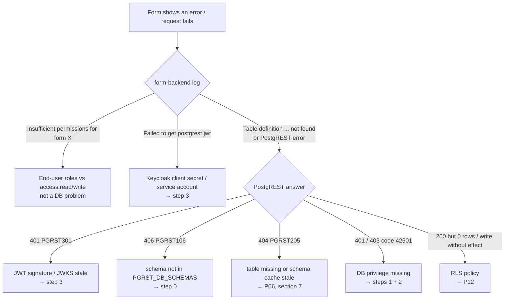

# Database Permission Checks: Production

This guide is a checklist for finding **permission errors** in a production deployment of form-backend. Production here means `docker-compose.yml` only, without `docker-compose.override.dev.yml`. The checks are mostly read-only and don't need the dev tooling (`initDev.sh`, mkcert, exposed ports, extra images).

For background on the data model, roles and the request flow, see the dev guide [database-debug.md](database-debug.md). This guide assumes the same roles: `authenticator`, `formbackend`, `web_anon`. For installations without Docker and without a `.env`, see [database-permission-checks-native.md](database-permission-checks-native.md); its script also contains the checks P16 (`23502`, `id` without a default), P01c and P14a/b that were added later.

Every query, script and command in this guide was tested against PostgreSQL 17 / PostGIS 3.5, PostgREST v13.0.7 and the image `ghcr.io/formcapture/form-backend:4.0.0`. Each check was run against a healthy database **and** against deliberately broken privileges (injected inside a transaction and rolled back), to confirm that it really reports the problem.

- [0. What is different in production](#0-what-is-different-in-production)
- [1. Ground rules](#1-ground-rules)
- [2. Step 0: collect parameters](#2-step-0-collect-parameters)
- [3. Step 1: SQL check suite](#3-step-1-sql-check-suite)
- [4. Step 2: privilege smoke test with EXPLAIN](#4-step-2-privilege-smoke-test-with-explain)
- [5. Step 3: PostgREST checks from the form-backend container](#5-step-3-postgrest-checks-from-the-form-backend-container)
- [6. Step 4: logs](#6-step-4-logs)
- [7. After fixing: what needs a reload](#7-after-fixing-what-needs-a-reload)
- [8. Error message → check](#8-error-message--check)

---

## 0. What is different in production

| Topic | Dev | Production | Consequence for permission debugging |
|-------|-----|------------|--------------------------------------|
| Setup | `initDev.sh` sets the `authenticator` password, the JWKS, the client secret and runs the migrations | Done by hand or by deployment tooling | Steps can be missing or half done: P03, P11, [5](#5-step-3-postgrest-checks-from-the-form-backend-container) |
| Init scripts | run on a fresh `postgres/data` | ran once, years ago, or never (external DB) | `GRANT ... ON ALL TABLES` covered only the tables that existed back then: P08, P13 |
| Compose files | `COMPOSE_FILE=docker-compose.yml:docker-compose.override.dev.yml` (from `.env.example`) | must be `docker-compose.yml` only | If you copy `.env.example`, remove the override from `COMPOSE_FILE` |
| Network access | DB on host port `6666`, form-backend debugger on `9229` | No DB and no PostgREST ports; only nginx `80/443` | Every check runs through `docker compose exec` |
| PostgREST logging | `PGRST_LOG_LEVEL=debug` | not set, so the default `error` applies | **401/403 are not logged.** See [6](#6-step-4-logs) |
| Data | test data | real data | No real write tests. Use `EXPLAIN` and `has_*_privilege` |

---

## 1. Ground rules

- **Connect as a superuser or the table owner.** `has_*_privilege()` and `SET ROLE` need that:
  ```bash
  docker compose exec db psql -U postgres
  ```
  With an external DB, use `psql` with your DBA account against that DB instead.
- **Don't test with real INSERT, UPDATE or DELETE statements**, not even inside `BEGIN … ROLLBACK`. A rolled-back write still:
  - fires triggers
  - takes row and table locks
  - uses up sequence values (`nextval` isn't transactional)

  The checks below use `has_*_privilege()` and `EXPLAIN`. `EXPLAIN` without `ANALYZE` runs PostgreSQL's privilege check but never executes the statement. This was verified: `fountains_id_seq` stayed unchanged.
- **The HTTP checks only read.** They never send POST, PATCH or DELETE to PostgREST.

Which layer produces a permission error:



---

## 2. Step 0: collect parameters

The checks need to know **which tables form-backend uses**. Every `tableName` in the form configs counts: `dataSource`, `lookupTables`, `joinTables` and `via`. A `tableName` without its own `schema` uses `POSTGREST_DEFAULT_SCHEMA`.

Run this from the deployment directory (where `.env` and `form-backend/form_configs/` are). The commands are **bash**. If your shell is fish or something else, start `bash` first, and run step 0 and the later steps **in the same bash session**. The variables only exist there.

```bash
bash   # if your login shell is not bash
set -a; source .env; set +a

# all tables referenced by form configs, schema-qualified, as a Postgres array literal
TABLES="{$(jq -r '.. | objects | select(has("tableName")) | "\(.schema // "DEFAULT").\(.tableName)"' \
  form-backend/form_configs/*.json | sed "s/^DEFAULT\./${PGRST_DEFAULT_SCHEMA}./" | sort -u | paste -sd, -)}"
SCHEMAS="{$PGRST_DB_SCHEMAS}"
echo "$TABLES"; echo "$SCHEMAS"
```

Example (the committed demo configs `fountains*.json`):
```
{sampledata.contacts,sampledata.fountains,sampledata.fountains_contacts,sampledata.fountains_pictures,sampledata.fountain_types,sampledata.inspections,sampledata.inspections_contacts}
{sampledata}
```

**Check S1: is every schema used in the configs exposed by PostgREST?** If not, requests fail with `406 PGRST106`:

```bash
jq -r '.. | objects | select(has("tableName")) | .schema // empty' form-backend/form_configs/*.json | sort -u \
  | grep -vxF -f <(echo "$PGRST_DB_SCHEMAS" | tr ',' '\n' | tr -d ' ') \
  | sed 's/^/schema used in form configs but not in PGRST_DB_SCHEMAS: /' || echo "OK: all config schemas are exposed"
```
```
OK: all config schemas are exposed
```

**Check S2: does form-backend use the schema you expect as its default?**
```bash
docker compose exec -T form-backend printenv POSTGREST_DEFAULT_SCHEMA
```

---

## 3. Step 1: SQL check suite

Save the script below as `permission-checks.sql` and run it. **Each check returns 0 rows when everything is fine.** Every row is a problem, most of them with a ready-to-run `fix` statement. Review the fix before you apply it.

```bash
echo "$TABLES"; echo "$SCHEMAS"   # both must start with "{"; if empty, run step 0 first
docker compose exec -T db psql -U postgres -X -v tables="$TABLES" -v schemas="$SCHEMAS" < permission-checks.sql
```

If the variables are empty, the script stops right away with `ABORT: -v tables / -v schemas must be array literals …`, instead of failing in every check with `malformed array literal: ""`.

Optional parameters: `-v auth_role=…`, `-v fb_role=…`, `-v anon_role=…` and `-v healthcheck=schema.table`, if your names differ from the defaults.

Pipe the output through this to get a one-line summary per check:
```bash
… < permission-checks.sql | awk '/^== /{h=$0; next} /\(0 rows\)/{print h" → OK"; next} /^\(/{print h" → FINDINGS"; next} /^ERROR/{print}'
```

### 3.1 What each check catches

| Check | Problem it finds | Symptom when it fails |
|-------|------------------|----------------------|
| **P01** | A role is missing, `authenticator` can't log in, an API role is SUPERUSER/BYPASSRLS, the password expires within 30 days (`VALID UNTIL`), or there's a connection limit | PostgREST can't connect / `role "X" does not exist` / RLS is silently bypassed |
| **P02** | `authenticator` isn't a member of `formbackend`/`web_anon` with `SET` (PostgreSQL ≥ 16) | `permission denied to set role "formbackend"` |
| **P03** | `authenticator` has no password, or an md5 hash instead of SCRAM | `password authentication failed for user "authenticator"` |
| **P04** | `CONNECT` on the database was revoked (common hardening: `REVOKE CONNECT … FROM PUBLIC`) | `permission denied for database` |
| **P05** | `pg_hba.conf` has syntax errors, or `trust`/`password` rules for non-loopback hosts | Login fails, or it's insecure |
| **P06** | A table named in a form config doesn't exist | `404 PGRST205`, form-backend: `Table definition … not found` |
| **P07** | `USAGE` on a schema is missing | `permission denied for schema X` |
| **P08** | Table privileges are missing: `formbackend` needs SELECT/INSERT/UPDATE/DELETE, `web_anon` needs SELECT | `42501 permission denied for table X` |
| **P09** | `USAGE` is missing on a sequence used in a column default (`nextval('…'::regclass)` and the older `nextval('…'::text)`) of a form table | `permission denied for sequence X` on create |
| **P09b** | Any sequence in the exposed schemas without `USAGE`. This catches sequences called from **triggers or functions**, which P09 can't link to a table. It can also list sequences no form uses; check `owned_by` | `permission denied for sequence X` on create |
| **P10** | `SELECT` is missing on a table referenced by a foreign key (lookups, embedding) | Lookup enum empty / `PGRST200` / `42501` |
| **P11** | The healthcheck table is missing, or `SELECT`/`UPDATE` on it is missing | form-backend exits at startup: `Insufficient privileges for role formbackend` |
| **P12** | RLS is enabled, but no policy applies to the role | **No error**: 0 rows, PATCH/DELETE return 204 and change nothing |
| **P13** | A table owner in the exposed schemas has no default privileges for `formbackend` | The **next** table created by that owner is invisible (P08 fails after the next migration) |
| **P14** | Over-privileged: `web_anon` can write, grants to `PUBLIC`, an API role owns objects or can `CREATE`, `authenticator` has direct privileges | Security finding, not an error |
| **P15** | Role-level settings (`statement_timeout`, `search_path`, …), for information | Timeouts or "relation does not exist" that look like permission errors |

### 3.2 Script `permission-checks.sql`

```sql
-- parameters: override with psql -v name=value, otherwise these defaults apply
\if :{?auth_role}   \else \set auth_role authenticator \endif
\if :{?fb_role}     \else \set fb_role formbackend \endif
\if :{?anon_role}   \else \set anon_role web_anon \endif
\if :{?schemas}     \else \set schemas '{sampledata}' \endif
\if :{?tables}      \else \set tables '{sampledata.fountains,sampledata.fountain_types}' \endif
\if :{?healthcheck} \else \set healthcheck sampledata.__form_backend_healthcheck \endif
-- stop early if -v tables / -v schemas were passed empty or not as an array literal
SELECT left(:'tables', 1) <> '{' OR left(:'schemas', 1) <> '{' AS params_invalid \gset
\if :params_invalid
  \echo 'ABORT: -v tables / -v schemas must be array literals like {schema.table,...} / {schema}.'
  \echo 'Got tables=' :'tables' ' schemas=' :'schemas'
  \echo 'Run step 0 in the same bash shell first (echo "$TABLES" must not be empty), or omit -v to use the defaults.'
  \quit
\endif
\pset null '∅'

\echo '== P01 roles and attributes'
SELECT e.role, e.expect, CASE
         WHEN r.rolname IS NULL THEN 'role does not exist'
         WHEN r.rolsuper THEN 'is SUPERUSER'
         WHEN r.rolbypassrls THEN 'has BYPASSRLS'
         WHEN e.expect = 'login' AND NOT r.rolcanlogin THEN 'cannot LOGIN'
         WHEN e.expect = 'nologin' AND r.rolcanlogin THEN 'can LOGIN (should be NOLOGIN)'
         WHEN r.rolvaliduntil < now() + interval '30 days' THEN 'password expires/expired at ' || r.rolvaliduntil
         WHEN r.rolconnlimit <> -1 THEN 'connection limit ' || r.rolconnlimit || ' (PostgREST pool needs enough)'
       END AS problem
FROM (VALUES (:'auth_role', 'login'), (:'fb_role', 'nologin'), (:'anon_role', 'nologin')) e(role, expect)
LEFT JOIN pg_roles r ON r.rolname = e.role
WHERE r.rolname IS NULL OR r.rolsuper OR r.rolbypassrls
   OR (e.expect = 'login') <> r.rolcanlogin
   OR r.rolvaliduntil < now() + interval '30 days'
   OR (e.expect = 'login' AND r.rolconnlimit <> -1);

\echo '== P02 authenticator can SET ROLE to fb/anon'
SELECT g.role AS missing_membership,
       format('GRANT %I TO %I WITH INHERIT FALSE, SET TRUE;', g.role, :'auth_role') AS fix
FROM (VALUES (:'fb_role'), (:'anon_role')) g(role)
WHERE NOT EXISTS (
  SELECT 1 FROM pg_auth_members a
  JOIN pg_roles r ON r.oid = a.roleid JOIN pg_roles m ON m.oid = a.member
  WHERE m.rolname = :'auth_role' AND r.rolname = g.role AND a.set_option);

\echo '== P03 authenticator password is set and SCRAM'
SELECT rolname,
       CASE WHEN rolpassword IS NULL THEN 'no password' ELSE 'not SCRAM-SHA-256 (md5?)' END AS problem
FROM pg_authid
WHERE rolname = :'auth_role' AND (rolpassword IS NULL OR rolpassword NOT LIKE 'SCRAM-SHA-256$%');

\echo '== P04 CONNECT on database'
SELECT current_database() AS db, :'auth_role' AS role,
       format('GRANT CONNECT ON DATABASE %I TO %I;', current_database(), :'auth_role') AS fix
WHERE NOT has_database_privilege(:'auth_role', current_database(), 'CONNECT');

\echo '== P05 pg_hba.conf problems'
SELECT line_number, type, database, user_name, address, auth_method, error
FROM pg_hba_file_rules
WHERE error IS NOT NULL
   OR (type LIKE 'host%' AND auth_method IN ('trust', 'password')
       AND address NOT IN ('127.0.0.1', '::1'));

\echo '== P06 tables from form configs that do not exist'
SELECT t AS missing_table
FROM unnest(:'tables'::text[]) t
WHERE to_regclass(t) IS NULL;

\echo '== P07 schema USAGE'
SELECT s AS schema, r AS role, format('GRANT USAGE ON SCHEMA %I TO %I;', s, r) AS fix
FROM unnest(:'schemas'::name[]) s, unnest(ARRAY[:'fb_role', :'anon_role']::name[]) r
WHERE NOT has_schema_privilege(r, s, 'USAGE');

\echo '== P08 missing table privileges (fb: CRUD, anon: SELECT)'
SELECT x.role, x.tbl, x.priv, format('GRANT %s ON %s TO %I;', x.priv, x.tbl, x.role) AS fix
FROM (
  SELECT r.role, t AS tbl, p AS priv
  FROM unnest(:'tables'::text[]) t
  CROSS JOIN (VALUES (:'fb_role', ARRAY['SELECT','INSERT','UPDATE','DELETE']),
                     (:'anon_role', ARRAY['SELECT'])) r(role, privs)
  CROSS JOIN LATERAL unnest(r.privs) p
  WHERE to_regclass(t) IS NOT NULL
) x
WHERE NOT has_table_privilege(x.role, x.tbl, x.priv)
ORDER BY 1, 2, 3;

\echo '== P09 sequences behind column defaults (nextval)'
-- identity columns are not listed: PostgreSQL does not check sequence privileges for them
WITH seqs AS MATERIALIZED (
  -- default nextval('seq'::regclass): recorded as dependency
  SELECT s.oid::regclass AS seq, ad.adrelid::regclass AS tbl
  FROM pg_attrdef ad
  JOIN pg_depend d ON d.classid = 'pg_attrdef'::regclass AND d.objid = ad.oid
                  AND d.refclassid = 'pg_class'::regclass
  JOIN pg_class s ON s.oid = d.refobjid AND s.relkind = 'S'
  WHERE ad.adrelid::regclass::text = ANY (:'tables'::text[])
  UNION
  -- default nextval('seq'::text): no dependency, parse the expression
  SELECT s.oid::regclass, ad.adrelid::regclass
  FROM pg_attrdef ad
  JOIN pg_class s ON s.oid = to_regclass(substring(pg_get_expr(ad.adbin, ad.adrelid) FROM 'nextval\(\(?''([^'']+)'''))
                 AND s.relkind = 'S'
  WHERE ad.adrelid::regclass::text = ANY (:'tables'::text[])
)
SELECT tbl, seq, format('GRANT USAGE, SELECT ON SEQUENCE %s TO %I;', seq, :'fb_role') AS fix
FROM seqs
WHERE NOT has_sequence_privilege(:'fb_role', seq, 'USAGE');

\echo '== P09b all sequences in exposed schemas without USAGE (triggers / functions calling nextval)'
WITH seqs AS MATERIALIZED (
  SELECT s.oid
  FROM pg_class s JOIN pg_namespace n ON n.oid = s.relnamespace
  WHERE s.relkind = 'S' AND n.nspname = ANY (:'schemas'::name[])
    -- identity sequences need no privilege; the healthcheck table is never inserted into
    AND NOT EXISTS (SELECT 1 FROM pg_depend d
                    WHERE d.classid = 'pg_class'::regclass AND d.objid = s.oid
                      AND (d.deptype = 'i' OR d.refobjid = to_regclass(:'healthcheck')))
)
SELECT oid::regclass AS seq,
       (SELECT d.refobjid::regclass FROM pg_depend d
         WHERE d.classid = 'pg_class'::regclass AND d.objid = seqs.oid
           AND d.refclassid = 'pg_class'::regclass AND d.deptype = 'a') AS owned_by,
       format('GRANT USAGE, SELECT ON SEQUENCE %s TO %I;', oid::regclass, :'fb_role') AS fix
FROM seqs
WHERE NOT has_sequence_privilege(:'fb_role', oid, 'USAGE');

\echo '== P10 SELECT on FK-referenced tables (lookups / embedding)'
SELECT DISTINCT c.conrelid::regclass AS tbl, c.conname, c.confrelid::regclass AS referenced, r.role,
       format('GRANT SELECT ON %s TO %I;', c.confrelid::regclass, r.role) AS fix
FROM pg_constraint c
CROSS JOIN (VALUES (:'fb_role'), (:'anon_role')) r(role)
WHERE c.contype = 'f'
  AND c.conrelid::regclass::text = ANY (:'tables'::text[])
  AND NOT has_table_privilege(r.role, c.confrelid, 'SELECT');

\echo '== P11 healthcheck table'
SELECT :'healthcheck' AS tbl, problem FROM (
  SELECT CASE
    WHEN to_regclass(:'healthcheck') IS NULL THEN 'table missing (migration not run?)'
    WHEN NOT has_table_privilege(:'fb_role', :'healthcheck', 'SELECT') THEN 'formbackend lacks SELECT'
    WHEN NOT has_table_privilege(:'fb_role', :'healthcheck', 'UPDATE') THEN 'formbackend lacks UPDATE'
  END AS problem) x
WHERE problem IS NOT NULL;

\echo '== P12 RLS enabled without a policy for fb/anon'
SELECT c.oid::regclass AS tbl, r.role, c.relforcerowsecurity AS forced,
       'RLS on, no policy for role → 0 rows / silent no-op writes' AS problem
FROM pg_class c
CROSS JOIN (VALUES (:'fb_role'), (:'anon_role')) r(role)
WHERE c.relrowsecurity
  AND c.oid::regclass::text = ANY (:'tables'::text[] || ARRAY[:'healthcheck'])
  AND NOT EXISTS (
    SELECT 1 FROM pg_policy p
    WHERE p.polrelid = c.oid
      AND (0 = ANY (p.polroles) OR (SELECT oid FROM pg_roles WHERE rolname = r.role) = ANY (p.polroles)));

\echo '== P13 table owners without default privileges (new tables get no grants)'
SELECT DISTINCT n.nspname AS schema, pg_get_userbyid(c.relowner) AS owner,
       format('ALTER DEFAULT PRIVILEGES FOR ROLE %I IN SCHEMA %I GRANT SELECT, INSERT, UPDATE, DELETE ON TABLES TO %I;',
              pg_get_userbyid(c.relowner), n.nspname, :'fb_role') AS fix
FROM pg_class c JOIN pg_namespace n ON n.oid = c.relnamespace
WHERE n.nspname = ANY (:'schemas'::name[]) AND c.relkind IN ('r','p','v','m')
  AND NOT EXISTS (
    SELECT 1 FROM pg_default_acl d
    WHERE d.defaclrole = c.relowner AND d.defaclobjtype = 'r'
      AND (d.defaclnamespace = n.oid OR d.defaclnamespace = 0)
      AND array_to_string(d.defaclacl, ',') LIKE '%' || :'fb_role' || '=%');

\echo '== P14 over-privileged (hardening)'
SELECT c.oid::regclass::text AS object, :'anon_role' AS role, p AS priv, 'anon role can write' AS problem
FROM pg_class c JOIN pg_namespace n ON n.oid = c.relnamespace
CROSS JOIN unnest(ARRAY['INSERT','UPDATE','DELETE','TRUNCATE']) p
WHERE n.nspname = ANY (:'schemas'::name[]) AND c.relkind IN ('r','p','v','m','f')
  AND has_table_privilege(:'anon_role', c.oid, p)
UNION ALL
SELECT c.oid::regclass::text, 'PUBLIC', 'any', 'privilege granted to PUBLIC'
FROM pg_class c JOIN pg_namespace n ON n.oid = c.relnamespace
WHERE n.nspname = ANY (:'schemas'::name[]) AND c.relkind IN ('r','p','v','m','f','S')
  AND EXISTS (SELECT 1 FROM aclexplode(c.relacl) a WHERE a.grantee = 0)
UNION ALL
SELECT c.oid::regclass::text, pg_get_userbyid(c.relowner), 'OWNER', 'API role owns object (bypasses RLS, can DROP)'
FROM pg_class c JOIN pg_namespace n ON n.oid = c.relnamespace
WHERE n.nspname = ANY (:'schemas'::name[]) AND c.relkind IN ('r','p','v','m','f','S')
  AND pg_get_userbyid(c.relowner) IN (:'auth_role', :'fb_role', :'anon_role')
UNION ALL
SELECT s::text, r, 'CREATE', 'API role can create objects in schema'
FROM unnest(:'schemas'::name[]) s, unnest(ARRAY[:'auth_role', :'fb_role', :'anon_role']::name[]) r
WHERE has_schema_privilege(r, s, 'CREATE')
UNION ALL
SELECT c.oid::regclass::text, :'auth_role', a.privilege_type, 'authenticator has direct privileges (should only switch roles)'
FROM pg_class c JOIN pg_namespace n ON n.oid = c.relnamespace
CROSS JOIN LATERAL aclexplode(c.relacl) a
WHERE n.nspname = ANY (:'schemas'::name[]) AND a.grantee = (SELECT oid FROM pg_roles WHERE rolname = :'auth_role');

\echo '== P15 role-level settings (info)'
SELECT r.rolname, coalesce(d.datname, '(all dbs)') AS db, s.setconfig
FROM pg_db_role_setting s
JOIN pg_roles r ON r.oid = s.setrole
LEFT JOIN pg_database d ON d.oid = s.setdatabase
WHERE r.rolname IN (:'auth_role', :'fb_role', :'anon_role');
```

Notes:
- **P03** reads `pg_authid` and needs a superuser. It only reports whether a hash exists and what kind; it never prints the hash.
- **P05** reads `pg_hba_file_rules` and needs a superuser. `trust` on `127.0.0.1`/`::1` is the default of the official image and only reachable from inside the container, so the check ignores it.
- **P09/P09b** skip identity columns (`GENERATED … AS IDENTITY`). PostgreSQL doesn't check sequence privileges for them; an INSERT as `formbackend` works without `USAGE` (verified).
- **P13** reports a finding on the demo setup too, because the init scripts set no default privileges. That's harmless as long as every migration that creates a table also grants on it.

### 3.3 Example output

Healthy demo database (summary view):
```
== P01 roles and attributes → OK
== P02 authenticator can SET ROLE to fb/anon → OK
…
== P12 RLS enabled without a policy for fb/anon → OK
== P13 table owners without default privileges (new tables get no grants) → FINDINGS
== P14 over-privileged (hardening) → OK
== P15 role-level settings (info) → OK
```

With injected faults. This shows what each check reports; the faults were rolled back:
```
== P01 roles and attributes
 authenticator | login  | password expires/expired at 2026-11-01 00:00:00+00
== P02 authenticator can SET ROLE to fb/anon
 formbackend        | GRANT formbackend TO authenticator WITH INHERIT FALSE, SET TRUE;
== P03 authenticator password is set and SCRAM
 authenticator | no password
== P06 tables from form configs that do not exist
 sampledata.nope
== P08 missing table privileges (fb: CRUD, anon: SELECT)
 web_anon | sampledata.fountain_types | SELECT | GRANT SELECT ON sampledata.fountain_types TO web_anon;
== P09 sequences behind column defaults (nextval)
 sampledata.fountains | sampledata.fountains_id_seq | GRANT USAGE, SELECT ON SEQUENCE sampledata.fountains_id_seq TO formbackend;
== P09b all sequences in exposed schemas without USAGE (triggers / functions calling nextval)
 sampledata.fountains_id_seq | sampledata.fountains | GRANT USAGE, SELECT ON SEQUENCE sampledata.fountains_id_seq TO formbackend;
== P10 SELECT on FK-referenced tables (lookups / embedding)
 sampledata.fountains | fountains_fk | sampledata.fountain_types | web_anon | GRANT SELECT ON sampledata.fountain_types TO web_anon;
== P11 healthcheck table
 sampledata.__form_backend_healthcheck | formbackend lacks UPDATE
== P12 RLS enabled without a policy for fb/anon
 sampledata.inspections | web_anon    | f | RLS on, no policy for role → 0 rows / silent no-op writes
 sampledata.inspections | formbackend | f | RLS on, no policy for role → 0 rows / silent no-op writes
== P14 over-privileged (hardening)
 sampledata.fountains       | web_anon    | INSERT | anon role can write
 sampledata.contacts        | formbackend | OWNER  | API role owns object (bypasses RLS, can DROP)
 sampledata                 | formbackend | CREATE | API role can create objects in schema
```

---

## 4. Step 2: privilege smoke test with EXPLAIN

`has_table_privilege()` only looks at the table itself. The real statement can still fail in cases P08 can't see:

- **Views:** the view **owner** needs privileges on the base tables. `has_table_privilege('formbackend', 'v', 'SELECT')` returns `t`, but the query fails with `permission denied for table <base table>`. This was reproduced.
- **Column-level privileges:** for example, `UPDATE … WHERE id = X` also needs `SELECT` on `id`. Without SELECT on the table, an UPDATE with a filter fails too, which is exactly what PostgREST sends for `PATCH ?id=eq.X`.

The block below runs `EXPLAIN SELECT/INSERT/UPDATE/DELETE` as each role, for each table. `EXPLAIN` runs the privilege check without executing anything. The whole block runs in a `READ ONLY` transaction and only reports **deviations** from the expected state: `formbackend` may do everything, `web_anon` may only `SELECT`.

```bash
docker compose exec -T db psql -U postgres -X -q -v tables="$TABLES" < smoke-test.sql
```

`smoke-test.sql`:
```sql
\if :{?fb_role}   \else \set fb_role formbackend \endif
\if :{?anon_role} \else \set anon_role web_anon \endif
\if :{?tables}    \else \set tables '{sampledata.fountains,sampledata.fountain_types}' \endif
SELECT left(:'tables', 1) <> '{' AS params_invalid \gset
\if :params_invalid
  \echo 'ABORT: -v tables must be an array literal like {schema.table,...}. Got:' :'tables'
  \quit
\endif

BEGIN READ ONLY;
SELECT set_config('dbg.tables', :'tables', true) IS NOT NULL AS tables_set,
       set_config('dbg.fb', :'fb_role', true) IS NOT NULL AS fb_set,
       set_config('dbg.anon', :'anon_role', true) IS NOT NULL AS anon_set;
DO $$
DECLARE
  r text; t text; op text; col text; stmt text; allowed boolean; expected boolean;
  report text := '';
BEGIN
  FOREACH r IN ARRAY ARRAY[current_setting('dbg.fb'), current_setting('dbg.anon')] LOOP
    FOREACH t IN ARRAY current_setting('dbg.tables')::text[] LOOP
      SELECT quote_ident(attname) INTO col FROM pg_attribute
       WHERE attrelid = t::regclass AND attnum > 0 AND NOT attisdropped ORDER BY attnum LIMIT 1;
      FOREACH op IN ARRAY ARRAY['SELECT','INSERT','UPDATE','DELETE'] LOOP
        stmt := CASE op
          WHEN 'SELECT' THEN format('EXPLAIN SELECT * FROM %s', t)
          WHEN 'INSERT' THEN format('EXPLAIN INSERT INTO %s DEFAULT VALUES', t)
          WHEN 'UPDATE' THEN format('EXPLAIN UPDATE %s SET %s = %s WHERE false', t, col, col)
          WHEN 'DELETE' THEN format('EXPLAIN DELETE FROM %s WHERE false', t)
        END;
        -- formbackend: everything allowed; anon: only SELECT
        expected := (r = current_setting('dbg.fb') OR op = 'SELECT');
        BEGIN
          EXECUTE format('SET LOCAL ROLE %I', r);
          EXECUTE stmt;
          allowed := true;
        EXCEPTION WHEN insufficient_privilege THEN
          allowed := false;
          stmt := SQLERRM;
        END;
        RESET ROLE;
        IF allowed <> expected THEN
          report := report || format(E'\n  %-12s %-6s %-35s %s', r, op, t,
            CASE WHEN allowed THEN 'ALLOWED (should be denied)' ELSE 'DENIED: ' || stmt END);
        END IF;
      END LOOP;
    END LOOP;
  END LOOP;
  RAISE NOTICE 'privilege smoke test: %', CASE WHEN report = '' THEN 'OK, all as expected' ELSE report END;
END $$;
ROLLBACK;
```

Healthy:
```
NOTICE:  privilege smoke test: OK, all as expected
```
With injected faults (`REVOKE SELECT ON contacts FROM formbackend`, `REVOKE UPDATE ON fountains FROM formbackend`, `GRANT DELETE ON fountain_types TO web_anon`):
```
NOTICE:  privilege smoke test:
  formbackend  SELECT sampledata.contacts                 DENIED: permission denied for table contacts
  formbackend  UPDATE sampledata.contacts                 DENIED: permission denied for table contacts
  formbackend  UPDATE sampledata.fountains                DENIED: permission denied for table fountains
  web_anon     DELETE sampledata.fountain_types           ALLOWED (should be denied)
```

The smoke test doesn't cover:
- **Sequence privileges:** `EXPLAIN INSERT` doesn't evaluate `nextval()`. P09/P09b cover that.
- **RLS outcomes:** it reports "allowed" even if a policy filters out every row. P12 covers that.

For a single statement, you can also run this by hand:
```sql
BEGIN READ ONLY;
SET LOCAL ROLE formbackend;
EXPLAIN (COSTS OFF) UPDATE sampledata.__form_backend_healthcheck SET last_start = now() WHERE id = 1;
ROLLBACK;
```

---

## 5. Step 3: PostgREST checks from the form-backend container

PostgREST has no published port in production, and its image has no shell. The form-backend image has Node with `fetch` (`ghcr.io/formcapture/form-backend:4.0.0`: Node v26). The script below runs **inside the form-backend container with form-backend's own environment**, so it tests exactly the configuration form-backend uses. It only sends GET requests, and it never prints the token.

```bash
docker compose exec -T form-backend node --input-type=module - \
  fountains,fountain_types,contacts,fountains_contacts,fountains_pictures,inspections,inspections_contacts \
  < pgrst-check.mjs
```
The argument lists table names in `POSTGREST_DEFAULT_SCHEMA`, without the schema prefix.

`pgrst-check.mjs`:
```js
// Read-only PostgREST checks with form-backend's own configuration (env of the form-backend container).
const { KC_AUTH_SERVER_URL, KC_REALM, POSTGREST_JWT_CLIENT_ID, POSTGREST_KEYCLOAK_CLIENT_SECRET } = process.env;
const PGRST = process.env.POSTGREST_URL ?? 'http://postgrest:3000';
const SCHEMA = process.env.POSTGREST_DEFAULT_SCHEMA ?? 'public';
const TABLES = (process.argv[2] ?? '').split(',').filter(Boolean);

const tokenRes = await fetch(`${KC_AUTH_SERVER_URL}/realms/${KC_REALM}/protocol/openid-connect/token`, {
  method: 'POST',
  body: new URLSearchParams({ client_id: POSTGREST_JWT_CLIENT_ID, client_secret: POSTGREST_KEYCLOAK_CLIENT_SECRET, grant_type: 'client_credentials' })
});
console.log('1 token endpoint:', tokenRes.status);
const { access_token: token } = await tokenRes.json();
const claims = JSON.parse(Buffer.from(token.split('.')[1], 'base64url').toString());
console.log('2 role claim (resource_access):', JSON.stringify(claims.resource_access?.[POSTGREST_JWT_CLIENT_ID]));

const get = (path, auth, schema = SCHEMA) => fetch(`${PGRST}${path}`, {
  headers: { 'Accept-Profile': schema, ...(auth ? { Authorization: `Bearer ${token}` } : {}) }
});

for (const [label, auth] of [['service', true], ['anonymous', false]]) {
  const res = await get('/', auth);
  const body = await res.json();
  const visible = Object.keys(body.definitions ?? {});
  console.log(`3 OpenAPI as ${label}: ${res.status}, visible: ${visible.join(',') || JSON.stringify(body)}`);
  const missing = TABLES.filter(t => !visible.includes(t));
  if (missing.length) console.log(`  NOT visible as ${label}: ${missing.join(',')}`);
}
for (const t of TABLES) {
  const res = await get(`/${t}?limit=1`, true);
  console.log(`4 GET /${t} as service: ${res.status}${res.ok ? '' : ' ' + await res.text()}`);
}
const hc = await get('/__form_backend_healthcheck?id=eq.1', true);
console.log('5 healthcheck row:', hc.status, await hc.text());
```

Healthy output:
```
1 token endpoint: 200
2 role claim (resource_access): {"roles":["formbackend"]}
3 OpenAPI as service: 200, visible: fountains_pictures,contacts,inspections,fountain_types,fountains,fountains_contacts,inspections_contacts,__form_backend_healthcheck
3 OpenAPI as anonymous: 200, visible: fountains_pictures,contacts,inspections,fountain_types,fountains,fountains_contacts,inspections_contacts
4 GET /fountains as service: 200
…
5 healthcheck row: 200 [{"id":1,"last_start":"2026-10-29T00:00:00"}]
```

| Line | Bad result | Cause | Next step |
|------|-----------|-------|-----------|
| 1 | `401` | Client secret wrong (`PGRST_KEYCLOAK_CLIENT_SECRET`), or the client is disabled | Keycloak: *Clients → postgrest-client → Credentials* |
| 2 | `undefined` or `{"roles":[]}` | The service account has no client role `formbackend` | Keycloak: *Clients → postgrest-client → Service account roles* |
| 3 | `401 PGRST301` | `PGRST_JWT_SECRET` (JWKS) doesn't match the realm keys, e.g. after a key rotation or a realm re-import | Update the JWKS from `/realms/<realm>/protocol/openid-connect/certs` and restart PostgREST |
| 3 | `NOT visible as service: X` | No privilege on X, or the table isn't in the schema cache | P08; [section 7](#7-after-fixing-what-needs-a-reload) |
| 4 | `401`/`403` `42501` | Privilege missing | P07, P08 |
| 4 | `404 PGRST205 Could not find the table … in the schema cache` | The table doesn't exist, or was created after PostgREST loaded its schema cache | P06; `NOTIFY pgrst, 'reload schema'` |
| 4 | `406 PGRST106` | Schema not exposed | Check S1 |
| 5 | `200 []` | The healthcheck row `id = 1` is missing. form-backend's startup PATCH then **still succeeds** (204 on 0 rows) | Re-insert the row (see the migration `V1.0.0_form_backend_testtable.sql`) |

---

## 6. Step 4: logs

**PostgreSQL** logs every failed statement (`log_min_error_statement = error` by default), including the SQL text:
```bash
docker compose logs db | grep -A1 'permission denied'
```
```
form-backend-demo-db  | 2026-10-29 10:29:33.582 UTC [94] ERROR:  permission denied for table fountains
form-backend-demo-db  | 2026-10-29 10:29:33.582 UTC [94] STATEMENT:  INSERT INTO sampledata.fountains (name) VALUES ('debug-test');
```
The log doesn't show which role was active. Even with `%u` in `log_line_prefix`, PostgreSQL logs the *session user*, which is always `authenticator` for PostgREST, not the role it switched to (verified). Use the PostgREST log to find the role.

**PostgREST** only logs 5xx errors at its default level `error`, and the production compose file doesn't set `PGRST_LOG_LEVEL`. So a `401`/`403` from a missing privilege is **not logged at all** (verified). To debug, set the level to `warn`, which logs all 4xx responses together with the role:

```yaml
# docker-compose.yml → services.postgrest.environment
PGRST_LOG_LEVEL: warn
```
```bash
docker compose up -d postgrest
docker compose logs -f postgrest
```
```
172.18.0.2 - web_anon [29/Oct/2026:12:57:59 +0000] "GET /__form_backend_healthcheck HTTP/1.1" 401 110 "" "node"
```
`info` additionally logs every successful request (`… - formbackend […] "GET /fountains?… HTTP/1.1" 200 …`).

**form-backend:**
```bash
docker compose logs form-backend | grep -E 'ERROR|Insufficient|swagger|postgrest'
```
With `LOG_LEVEL=verbose`, form-backend logs the `resource_access` of every service token it fetches.

---

## 7. After fixing: what needs a reload

| Change | Takes effect | Verified |
|--------|--------------|----------|
| `GRANT` / `REVOKE` on an existing table | **Immediately**, for queries and for OpenAPI visibility | yes |
| New table, new column, new FK, new view or function | Only after PostgREST reloads its schema cache. Until then: `404 PGRST205` / the table is missing from OpenAPI | yes |
| Role membership, password | Immediately for new connections. Restart PostgREST if its pool still holds broken connections | – |
| `PGRST_*` environment | After `docker compose up -d postgrest` | – |
| Form config (`form_configs/*.json`) | Read again on the next request | – |

Reload the schema cache without a restart:
```sql
NOTIFY pgrst, 'reload schema';
```
The PostgREST log confirms the reload:
```
Schema cache loaded 9 Relations, 7 Relationships, 0 Functions, 0 Domain Representations, 4 Media Type…
```

**Migration template for a new table.** Without default privileges (P13), every migration has to grant explicitly:
```sql
CREATE TABLE sampledata.new_table (id serial PRIMARY KEY, name varchar);
GRANT SELECT, INSERT, UPDATE, DELETE ON sampledata.new_table TO formbackend;
GRANT USAGE, SELECT ON SEQUENCE sampledata.new_table_id_seq TO formbackend;
GRANT SELECT ON sampledata.new_table TO web_anon;   -- only if anonymous read via PostgREST is intended
NOTIFY pgrst, 'reload schema';
```

---

## 8. Error message → check

| Message | Source | Check |
|---------|--------|-------|
| `password authentication failed for user "authenticator"` | PostgREST log | P01 (expiry), P03, P05 |
| `permission denied for database …` | PostgREST log | P04 |
| `permission denied to set role "formbackend"` | PostgREST | P02 |
| `role "…" does not exist` | PostgREST | P01, step 3 line 2 |
| `permission denied for schema …` | PostgREST / DB log | P07 |
| `42501 permission denied for table …` (401 anonymous, 403 with token) | PostgREST | P08, P10, step 2 |
| `permission denied for sequence …` | PostgREST on create | P09, P09b |
| `404 PGRST205 … schema cache` | PostgREST | P06, [section 7](#7-after-fixing-what-needs-a-reload) |
| `406 PGRST106 Invalid schema` | PostgREST | S1 |
| `401 PGRST301` | PostgREST | step 3 line 3 |
| `Failed to get postgrest jwt` | form-backend | step 3 lines 1-2 |
| `Insufficient privileges for role formbackend` (process exits) | form-backend startup | P11 |
| `Table definition for table X not found in swagger doc` | form-backend | P06, P08, step 3 line 3 |
| `Insufficient permissions for form X` | form-backend | not a DB problem: end-user roles vs `access` in the form config |
| 0 rows, writes "succeed" without effect | – | P12 |
